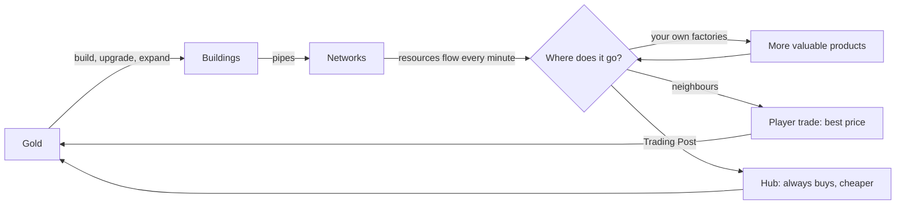
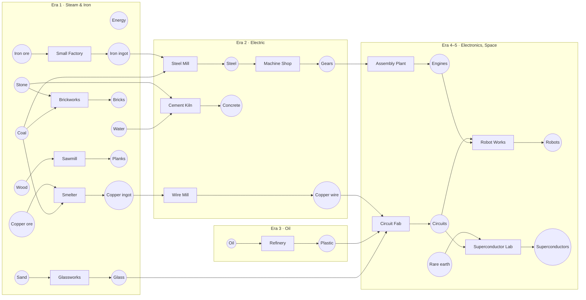
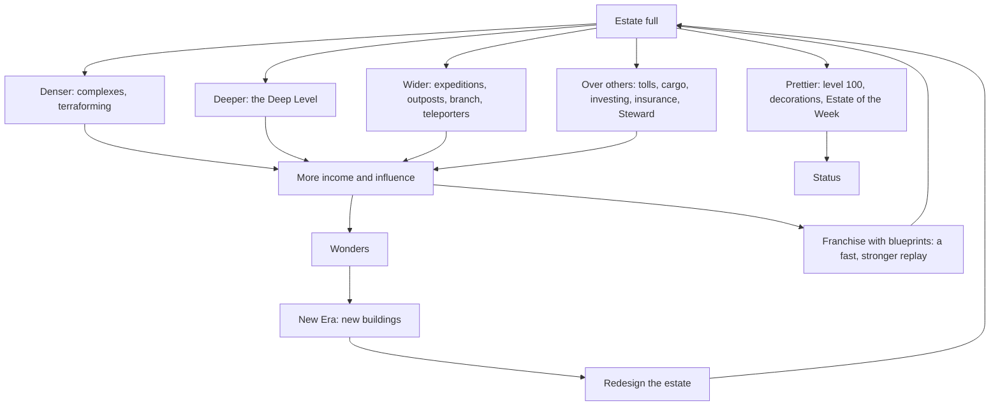

# Transport Pipes — Game Design Document

Version 1.0 · October 2026 · Design for the full game

> **One sentence:** Transport Pipes is a massively multiplayer idle tycoon in which every player develops an industrial
> estate on one shared isometric map, connects factories with pipes, and gets richer by connecting to the neighbours, all
> while offline as well.

## Contents

1. [The game in one minute](#1-the-game-in-one-minute)
2. [Design pillars](#2-design-pillars)
3. [What changed since the first draft](#3-what-changed-since-the-first-draft)
4. [The world](#4-the-world)
5. [Core mechanics](#5-core-mechanics)
6. [Resources and production chains](#6-resources-and-production-chains)
7. [Building catalog](#7-building-catalog)
8. [Progression](#8-progression)
9. [Multiplayer systems](#9-multiplayer-systems)
10. [The player journey: fun for days and weeks](#10-the-player-journey-fun-for-days-and-weeks)
11. [When your estate is full: the late game](#11-when-your-estate-is-full-the-late-game)
12. [Inactive players, moving and space in the world](#12-inactive-players-moving-and-space-in-the-world)
13. [Fun at every stage](#13-fun-at-every-stage)
14. [Economy and balancing](#14-economy-and-balancing)
15. [Events](#15-events)
16. [Screens and UX](#16-screens-and-ux)
17. [Art and audio direction](#17-art-and-audio-direction)
18. [Technical design](#18-technical-design)
19. [Monetisation and fairness](#19-monetisation-and-fairness)
20. [Metrics](#20-metrics)
21. [Roadmap](#21-roadmap)
22. [Risks](#22-risks)
23. [Glossary](#23-glossary)

---

## 1. The game in one minute

You run an industrial company in a world shared with thousands of other players.

1. **You get an estate.** A valley of your own, 32×32 tiles, in a *district* around a hub city. Other players' estates
   are around yours.
2. **You build.** Generators make energy, mines dig ore, factories turn resources into more valuable products, storages
   buffer, and your Trading Post sells to the hub.
3. **You connect buildings with pipes.** Buildings connected by pipes form a *network*. Every minute, resources flow
   automatically from the buildings that make them to the buildings that need them, even when you are offline.
4. **You earn gold when resources leave your company:** sold to the hub through your Trading Post, or bought by a
   neighbour whose buildings are connected to your network.
5. **You spend gold to grow:** more buildings, upgrades, more land, research.
6. **Nobody has everything.** Your estate has some resources (say iron and wind) and lacks others (copper, sand). The
   hub sells everything, but expensive, and buys everything, but cheap. Players trade *between* those two prices, so
   connecting your pipes to a neighbour pays **both** of you more than the hub. That is the multiplayer.
7. **The whole server builds Wonders together.** Every Wonder that is finished starts a new *Era* with new resources and
   buildings, for everyone, until the season finale.



**Genre references:** AdVenture Capitalist (idle, prestige), Factorio and Satisfactory (production chains, logistics),
OpenTTD (infrastructure, tolls), Travian (shared map, slow real time), EVE Online (a player driven economy).

## 2. Design pillars

| Pillar | What it means | How we check it |
| --- | --- | --- |
| **Everything flows** | Resources visibly move through pipes; the map is the interface | A player can tell what an estate does by looking at it |
| **Better together, never forced** | Solo works (through the hub), trading with neighbours always pays more | More than 60% of players trade with at least one other company |
| **Progress while away, never lose it** | Full offline progress; nobody can destroy what you built | No mechanic punishes an offline player |
| **A world that moves** | Markets, events, Eras, new districts | Something new happens every day |
| **Every check-in has a decision** | A 2 minute visit always offers something worth doing | Median check-in has at least one spend or choice |
| **Your estate tells your story** | Big land, visual growth of buildings, decorations | Players visit and screenshot each other's estates |

## 3. What changed since the first draft

| First draft | Now | Why |
| --- | --- | --- |
| A plot was one 8×8 chunk, claimed anywhere | An **estate** of 32×32 tiles (16 parcels), assigned in a **district** | Plots felt tiny; a big valley to develop is the heart of an idle builder |
| Free-form claiming, land tax against hoarding | Estates are assigned, land grows by **buying parcels**; no land tax | Clear, fair, no hoarding problem, no punishment while offline |
| Ports anywhere on the border | Four **gates** per estate on public **corridors**, every gate has a policy | Neighbours can always reach each other; nobody can tap your land |
| Allocation of resources was implicit | A clear **flow order** (own factories → contracts → neighbours → storage → hub) | Players must understand where their resources go |
| No goals between "first building" and "Era" | **Company Level** with an unlock per level, daily orders, a day-by-day journey | Fun over multiple days needs a steady stream of new toys |
| 3 resources, 7 buildings | 21 resources, 60 buildings (1×1, 2×2 and 3×3) with animations and visual growth | Depth, variety and something to look at |
| Empty world at launch was a risk | **NPC tenants** fill empty estates and trade like players | There is always a neighbour, also on day one of a new district |
| Seasons undecided | **Seasons of ~12 weeks** with five Eras and a finale, Legacy carries over | A satisfying ending and a fresh start keep the economy healthy |
| Nothing new once the land is full | **Six late-game paths** (§11): denser, deeper (the Deep Level), wider (expeditions, branches, teleporters), over others (infrastructure, finance, governance), prettier, Franchise | The game must stay fun after the estate is complete |
| Inactive players occupied land | **Activity stages** with a Caretaker, sleeping estates move to the **Quiet Isles**, free relocation on return (§12) | Districts stay lively, nobody loses anything |
| No moving | **Relocation** of the whole estate, crates, swaps, corporation blocks (§12.3) | Play next to friends and good partners |
| Four gates per estate on public corridors, a gate policy each, shared corridor networks | **v1.2:** estates sit in **stations** of four (or two) seats around a shared **Yard**; one Yard gate per estate; networks never cross a gate; one **player price** (1.75 × base) for the Yard, links, contracts and the Exchange; **links** join two named companies in different stations | Three friends play together the first evening, nobody can block or fleece anybody, the district never becomes one network ([multiplayer-design.html](multiplayer-design.html)) |
| One hub price per district that everyone's sales move | **v1.2:** a personal **Hub Order** per company and hub (√ curve), quiet grace on small servers; public copper **trunks** to the next hubs and the Port, crew steel trunks | Nobody's flood lowers a newcomer's price; growth in week 3 comes from crossing borders |
| NPC tenants on free estates | **v1.2:** **Houses** ⚙ of four kinds as strong as their station, in every free seat on a small server, a starter kit for the newcomer who takes the seat; **stand-ins** keep a sleeper's trades | Never alone, never silent, and labelled: they never pretend to be people |
| The Quiet Isles at day 30, a move once a week | **v1.2:** asleep in place (the seat held to day 90 in a crew, 37 alone), the way back's screens and landing cards; moves to a chosen seat, free, 5 minutes apart | Absence costs nobody else; coming back is a gift |
| Corporations as the only groups | **v1.2:** **crews** of 1–8 friends (seat codes, guests), the **station's project** (Foundation → Landmark), Asks, the Plan board, tending, Discoveries with markers, leagues | Doing things together without votes, kicks or appointments |

## 4. The world

### 4.1 Structure

The world consists of **districts**. A district is a hub city with 24 estates around it, separated by public
**corridors**. Between districts lies **wilderness** with rare deposits.

```
        ┌──────┬──────┬──────┬──────┬──────┐
        │ E    │ E    │ E    │ E    │ E    │      E = estate, 32×32 tiles (16 parcels of 8×8)
        ├══════┼══════┼══════┼══════┼══════┤      H = hub city, 32×32 tiles
        │ E    │ E    │ E    │ E    │ E    │      ═ = corridor, 2 tiles wide:
        ├══════┼══════┼══════┼══════┼══════┤          the hub's trunk line + a lane for player pipes
        │ E    │ E    │  H   │ E    │ E    │
        ├══════┼══════┼══════┼══════┼══════┤      One district = 170×170 tiles, 24 estates.
        │ E    │ E    │ E    │ E    │ E    │      Districts are 32 tiles of wilderness apart.
        ├══════┼══════┼══════┼══════┼══════┤
        │ E    │ E    │ E    │ E    │ E    │
        └──────┴──────┴──────┴──────┴──────┘
```

- The first district is the **Capital**, around Central Exchange at (0,0) (today's "LOADING" tile becomes the hub).
- New districts open on the frontier when the existing ones fill up. New players start in the newest district, or next
  to a friend with an invite code (the friend's district reserves an estate for 24 hours).
- **Scale:** 1,000 active players ≈ 42 districts. Districts are also the unit of simulation (see §18).

### 4.2 Terrain and biomes

| Terrain | Look | Gameplay |
| --- | --- | --- |
| Grassland | Green, flowers | Builds anything |
| Hills | Raised tiles, rocks | Wind ×1.2–1.6; stone; no 3×3 buildings |
| Forest | Tree clusters | Wood; trees are cleared by building (gives wood) and regrow around Lumber Camps |
| Beach | Sand | Sand |
| Water (lakes, rivers) | Animated waves | Unbuildable; Water Pumps, Hydro Wheels and Docks on the shore; pipes cross with bridges |
| Desert | Dunes, cacti | Sun ×1.5; oil (Era 3) |
| Mountains | Tall rock decor | Unbuildable; rich ore deposits at their feet |
| Deposits | Decals on the tiles | Iron, copper, coal, stone, oil, rare earth; richness ★1–★5 multiplies extraction |

Two continuous **climate maps** (wind and sun) are shown as overlays, so where you build matters.

### 4.3 Estates

Every estate is generated with:

- **Guaranteed basics:** an iron deposit, a hill or sunny area, some grassland, a corridor gate on every side.
- **One or two specialties**, different from most neighbours, so trading is needed for later chains:

| Specialty | Contents | Strong in |
| --- | --- | --- |
| Windy Heights | Big hills, wind ×1.6 | Energy |
| Sunny Flats | Desert patch, sun ×1.5 | Energy, later oil |
| Riverside | A river, beach | Water, sand, glass, hydro power |
| Copper Gulch | Copper ★4, small mountain | Copper, wire |
| Coal Valley | Coal ★4, stone | Coal, bricks, steel |
| Old Forest | Large forest | Wood, planks, charcoal |
| Stone Quarry | Stone ★4, hills | Stone, concrete |

**Parcels.** An estate has 16 parcels of 8×8 tiles. You start with the 4 central parcels (16×16 tiles) and the
**Company HQ** in the middle. The other 12 parcels are visible (you see their deposits and trees) and can be bought one
by one; their cost doubles each time, and Company Levels gate them (§8.1). Choosing *which* parcel to buy next is one of
the regular decisions of the first weeks.

### 4.4 Hub cities

The hub in the centre of each district is a city run by the game. It provides:

| Service | What it does |
| --- | --- |
| **Market** | Buys every resource (cheap) and sells every resource (expensive). Prices react to supply and demand (§14.4) |
| **Daily orders** | Three personal orders per day, e.g. "deliver 400 bricks before midnight" |
| **Contract board** | Players post and accept contracts (§5.7) |
| **Exchange** | Order book between storages, delivered by cargo (§5.8) |
| **Wonder site** | District Wonder (district perk) and, in the Capital, the server Wonder (next Era) |
| **Corporation quarter** | Corporation HQs stand here, visible to the whole district |
| **Town hall** | The District Steward (§11.5), the blueprint board, the weekly challenge (§11.8) |

Each hub has a **specialty demand** (e.g. Riverside pays +20% for glass, changes weekly) and a **hub level** that grows
with the total trade of its district (more demand, better services, cosmetic growth of the city).

### 4.5 Corridors, gates and the trunk line

- **Corridors** are 2 tiles wide. One lane holds the hub's **trunk line**, a big decorative pipe that links every
  Trading Post to the hub market. The other lane is for **player pipes**.
- Every estate has a **gate** in the middle of each side. A gate is where your network can meet a neighbour's.
- **Gate policy:** *Closed*, *Corporation only*, *Contract only* or *Open*. You can only be connected through a gate whose
  policy allows it, so nobody can tap your estate.
- **Public pipes:** player pipes in corridors belong to whoever built them. The owner may put a **Toll Meter** on them
  (max 5%). Building the pipe between two estates is cheap, so most connections are a pipe of 2–10 tiles from gate to
  gate.

### 4.6 Wilderness and outposts

From Company Level 15 you can claim **outposts**: 8×8 claims on rare wilderness deposits (copper ★5, coal ★5, oil,
rare earth). Outposts are limited (3 per company), cost a weekly lease and need logistics: a long pipe back to your
gate (losses!) or a **Cargo Depot** that ships to your estate. New rich deposits appear during *Discovery* events, which
causes friendly land rushes.

### 4.7 NPC tenants

Estates that are not taken by players are run by **NPC tenants**: simple companies with a fixed specialty that buy and
sell at fair prices through their open gates. They make sure:

- a new district never feels empty;
- the trade tutorial always has a partner;
- small players have customers for their surplus.

**Direct partners only (v1.1):** goods between two companies travel only through those two companies' estates (and
over their own pipes), the corridors and the wilderness: never through a third company's estate. Your trade partners
are the companies you pipe to yourself; a tenant that pipes all four of its gates no longer joins the corridors into
one market. Pump stations count per company: only your own buildings need your pumps.

A tenant's works (an Ironworks, a Brickworks) import from the hub whatever no neighbour brings, so they always run: any
one of their inputs sells to them on its own, and neighbours come first (they are cheaper than the hub). Without that, a
works short of ore would buy no one's energy either, and a new player whose own factory uses all of its ore would have
nothing to sell. What tenants sell to the hub doesn't move its prices (those follow the players). When a player is
connected to a neighbour but no trade comes, Loady says why (nothing spare, or they don't need it).

When a player is assigned to a tenant's estate, the tenant "moves out" (its buildings become free ruins the new owner
can salvage).

## 5. Core mechanics

### 5.1 Buildings

- **Placement:** on your unlocked parcels, on fitting terrain (an Iron Mine needs an iron deposit, a Water Pump needs a
  shore). Footprints are 1×1, 2×2 or 3×3.
- **Construction:** costs gold (and from Era 2 also materials), takes time (seconds early, hours late) and shows
  scaffolding and a crane.
- **Levels:** every building can be upgraded (1–100). Output grows each level and doubles at milestones (10, 25, 50, 75,
  100). Buildings visibly evolve at milestones (§17.3).
- **States:** *working*, *idle* (no input or no buyer, lights off), *blocked* (output full, red light), *damaged*
  (storm, works at 50% until repaired), *upgrading*.
- **Moving and demolishing:** your own buildings can be moved (free, short rebuild time) or demolished (50% refund).
  Nobody else can touch them.

### 5.2 Pipes and networks

- Buildings touching a pipe are connected; buildings touching each other are not. Resources never pass *through* a
  building: two buildings exchange resources when they touch the same pipe group. Everything connected is one
  **network**.
- Pipes may be laid on every parcel of your own estate, also the ones you haven't bought yet (buildings need bought
  parcels), so every gate can be reached from the start.
- Pipes carry every resource. (Era 2 adds **power lines** for energy only: long range, no losses, crossing water.)
- **Pipe tiers:**

| Pipe | Unlock | Cost per tile | Loss per tile | Throughput per connection |
| --- | --- | --- | --- | --- |
| Grey Pipe | Start | 2 g | 0.3% | 100 / min |
| Copper Pipe | Research | 10 g + 1 copper ingot | 0.15% | 500 / min |
| Steel Pipe | Era 2 | 40 g + 1 steel | 0.05% | 5,000 / min |
| Glass Conduit | Era 4 | 200 g + glass, circuits | 0.01% | 50,000 / min |

(Tuned in play: at 1% a grey pipe to a neighbour a hundred tiles away delivered a third, so trading only paid next
door. At 0.3% three quarters arrive, and a neighbour pays more than the hub up to about 190 tiles.)
| Superconductor | Era 5 | expensive | 0 | unlimited |

- **Losses** are counted over the shortest pipe path between producer and consumer, so compact layouts and good trunk
  pipes pay off.
- **Valves** let only chosen resources pass; **Priority Valves** decide which side is served first; **Pump Stations**
  are required for every 50 buildings in a network (keeps networks meaningful and the simulation bounded).
- **Overlays:** flow (animated dots per resource), ownership, losses, bottlenecks.

### 5.3 The flow rules

Every producer in a network delivers its output each minute in this order:

1. **Your own consumers** in the network (factories, labs, Wonders you feed).
2. **Contract partners**, up to the contracted amount.
3. **Other companies' consumers** in the network whose maximum price is at or above your price, divided in proportion
   to what they need. A consumer that can't use its full share (it is short of another input) leaves the rest to the
   others, so every consumer runs at the same speed unless something else holds it back.
4. **Your storages**, what they keep: what your daily orders, your corporation's goal and your next building still need
   (enough for the building you can build that needs the most of it), or more when you choose a share of the
   storage for it (a tenth, half, everything).
5. **Your Trading Post**, sold to the hub at the hub price.
6. **Your storages** again: whatever the Trading Post couldn't take (it is full, or there is none), until full.
7. Nothing left to deliver to → the producer runs slower (**idle**) instead of wasting.

Consumers are supplied in the mirrored order: own producers → contract partners → cheapest other company → own storage →
hub import (only if you enabled imports on your Trading Post).

A storage that kept everything first would swallow a new company's income for hours, so by default it keeps only what
is needed. You can switch off step 3 per resource.

> **Example.** Your two Wind Moilies make 60 ⚡/min. Your Iron Mine needs 10. IronWorks' factory next door needs 40 and
> pays up to 2 g; your price is 1.75 g. The flow: 10 to your mine, 40 to IronWorks at 1.75 g (+70 g/min), the last 10
> to your storage if today's orders need it, else to the hub at 1 g. Losses on the 6 pipe tiles to their gate (2%) are
> taken from the delivered amount.

### 5.4 Storage

Storages hold any resource up to their capacity (Storage 5,000, Warehouse 50,000, Silo 500,000). A full storage is the
main *reason to come back*: it shows up in the offline report with a one-tap upgrade. Storages are also what you list on
the Exchange.

### 5.5 Trading with the hub

- Your **Trading Post** (one free at your gate, more can be built) sells everything that reaches it at the hub's **buy
  price**, and can import resources at the hub's **sell price** (2.5× the buy price).
- Prices react to how much all players sell and buy (§14.4): flood the hub with iron ore and its price drops; that is a
  hint to process the ore or sell it elsewhere.
- Trading Posts have a throughput (600 units/min at level 1).

### 5.6 Trading with players

- **How to connect:** open the **Neighbourhood** panel. It lists nearby companies with their surplus and needs
  ("NovaPower: +300 ⚡/min spare · needs iron ingots"). *Connect* shows a ghost pipe from your gate to theirs with its
  cost; the other side gets a request (or it connects immediately when their gate is *Open*).
- **Prices:** you set one price per resource for everything you sell to other players, within the **fair band**
  between the hub's buy price and sell price. The default *Auto* price is the middle. Buyers set a maximum price per
  resource (default: the hub's sell price).
- **Why both win:** the seller gets more than the hub pays, the buyer pays less than the hub charges.
- **Notice period:** price changes, gate closings and demolitions that affect a partner take effect after 1 hour, and the
  partner is notified. Nobody wakes up to a collapsed factory.
- **Visibility:** every building shows who receives its output, at which price, and the gold it earns.

### 5.7 Contracts

A contract fixes an amount, price and duration ("300 iron ingots per minute for 7 days at 20 g"). Contracts:

- are offered at a gate, to a company, or posted publicly on the hub's contract board;
- come before open trade in the flow rules (§5.3), so they are reliable;
- track delivery automatically; shortfalls cost a penalty (default 5%) and **reputation** (★1–5);
- can be one-off deliveries (e.g. "deliver 10,000 bricks to my Wonder contribution") or recurring.

### 5.8 The Exchange and cargo

For trade without a pipe connection. Players list storage contents on their hub's order book (or any hub, with a
longer delivery). Deliveries go by **cargo** (trucks, later trains), taking time by distance, and cost a fee of which
half is destroyed. Pipes stay the cheapest way; the Exchange solves distance and outposts.

### 5.9 Currencies

| Currency | Earned by | Spent on |
| --- | --- | --- |
| **Gold** | Selling to the hub and to players, orders, contracts | Everything |
| **Research Points (RP)** | Labs (consume resources) | Research |
| **Hub reputation** | Daily orders, trade with the hub | Better hub prices, special orders, cosmetics |
| **Shares** | Franchise (prestige) | Permanent production bonus |
| **Legacy** | End of a season | Account perks and cosmetics for the next seasons |

There is no premium currency.

### 5.10 Time and offline progress

Everything runs continuously, also offline. The world is simulated per *event* (§18.1): between two events every network
runs at constant rates, so offline time costs nothing to calculate and is exact. The **offline report** shows what
happened: earnings, full storages, contracts, events, damaged buildings, new neighbours.

## 6. Resources and production chains

### 6.1 Resources

| Resource | Icon colour | Tier | Era | From | Hub buys (base) |
| --- | --- | --- | --- | --- | --- |
| Energy | yellow | 1 | 1 | Solar, wind, hydro, coal, fusion | 1 |
| Water | light blue | 1 | 1 | Water Pump | 0.5 |
| Iron ore | rust | 1 | 1 | Iron Mine | 3 |
| Copper ore | orange | 1 | 1 | Copper Mine | 3.5 |
| Coal | black | 1 | 1 | Coal Pit | 2.5 |
| Stone | grey | 1 | 1 | Quarry | 1.5 |
| Sand | beige | 1 | 1 | Sand Dredger | 1.2 |
| Wood | brown | 1 | 1 | Lumber Camp | 1.5 |
| Iron ingot | silver | 2 | 1 | Small Factory | 14 |
| Copper ingot | copper | 2 | 1 | Smelter | 18 |
| Bricks | brick red | 2 | 1 | Brickworks | 5 |
| Glass | cyan | 2 | 1 | Glassworks | 14 |
| Planks | light brown | 2 | 1 | Sawmill | 3.5 |
| Steel | lilac | 3 | 2 | Steel Mill | 60 |
| Copper wire | copper/white | 3 | 2 | Wire Mill | 40 |
| Concrete | blue grey | 3 | 2 | Cement Kiln | 18 |
| Gears | dark silver | 3 | 2 | Machine Shop | 110 |
| Oil | dark purple | 1 | 3 | Oil Derrick | 8 |
| Plastic | pink | 3 | 3 | Refinery | 45 |
| Circuits | green | 4 | 4 | Circuit Fab | 400 |
| Rare earth | violet | 1 | 4 | Rare Earth Excavator | 30 |
| Engines | steel blue | 4 | 4 | Assembly Plant | 1,500 |
| Robots | white | 5 | 4 | Robot Works | 6,000 |
| Superconductors | glowing blue | 5 | 5 | Superconductor Lab | 25,000 |

The hub sells every resource at 2.5× its buy price.

### 6.2 Chains



Almost every factory also needs energy. Processing raises value: 12 iron ore (36 g) plus 20 energy (20 g) become 6
iron ingots (84 g).

## 7. Building catalog

Footprints: **S** = 1×1, **M** = 2×2, **L** = 3×3. Rates are per minute at level 1. Every building has a construction
animation (scaffolding, crane), a working loop, an idle frame and a blocked state (§17.2).

### 7.1 Energy

| Building | Size | Unlock | In → out | Placement / notes | Animation |
| --- | --- | --- | --- | --- | --- |
| Solar Panel | S | Start | → 5 ⚡ | ×sun (0.7–1.5) | Panels tilt with the day, glints |
| Wind Moily | S | Start | → 30 ⚡ | ×wind (0.6–1.6) | Blades spin; speed follows the wind |
| Hydro Wheel | S | Research | → 40 ⚡ | On a river bank | Wheel turns, water splashes |
| Coal Plant | M | Lv 14 | 10 coal + 20 water → 200 ⚡ | | Chimney smoke, glowing furnace door |
| Big Turbine | M | Era 2 | → 400 ⚡ | ×wind, hills | Huge three-blade turbine, blinking light |
| Steam Turbine | M | Era 2 | 30 coal + 40 water → 900 ⚡ | | Steam puffs, spinning flywheel |
| Solar Farm | L | Era 3 | → 1,200 ⚡ | ×sun | Rows of panels, sun reflections wave |
| Geothermal Plant | M | Era 4 | 10 water → 3,000 ⚡ | Volcanic deposit | Steam vents, bubbling pool |
| Fusion Reactor | L | Era 5 | 1 superconductor + water → 50,000 ⚡ | | Pulsing plasma ring, rotating shell |

### 7.2 Extraction

| Building | Size | Unlock | In → out | Placement / notes | Animation |
| --- | --- | --- | --- | --- | --- |
| Iron Mine | S | Lv 2 | 10 ⚡ → 12 iron ore | Iron deposit, ×richness | Mine cart rolls out and back |
| Copper Mine | S | Lv 5 | 12 ⚡ → 10 copper ore | Copper deposit | Cart with orange ore, lantern |
| Coal Pit | S | Lv 5 | 8 ⚡ → 12 coal | Coal deposit | Bucket elevator, black dust |
| Quarry | M | Lv 10 | 15 ⚡ → 20 stone | Stone deposit / hills | Saw cutting blocks, dust clouds |
| Sand Dredger | S | Lv 5 | 8 ⚡ → 15 sand | Beach / shore | Bucket wheel turning |
| Lumber Camp | S | Lv 5 | 4 ⚡ → 10 wood | Next to forest; replants | Lumberjack chops, tree falls and regrows |
| Water Pump | S | Lv 5 | 2 ⚡ → 20 water | Shore | Piston pump bobbing |
| Deep Mine | M | Era 2 | 60 ⚡ → 80 ore (any metal) | Deposit ★3+ | Head frame wheel turning |
| Oil Derrick | S | Era 3 | 20 ⚡ → 10 oil | Oil deposit (desert, outposts) | Nodding pump jack |
| Rare Earth Excavator | M | Era 4 | 200 ⚡ → 5 rare earth | Rare earth deposit (outposts) | Excavator arm digging, violet sparkles |

### 7.3 Processing

| Building | Size | Unlock | In → out | Animation |
| --- | --- | --- | --- | --- |
| Small Factory | S | Lv 2 | 20 ⚡ + 12 iron ore → 6 iron ingot | Smoke, glowing window (exists) |
| Smelter | S | Lv 6 | 20 ⚡ + 10 copper ore + 4 coal → 5 copper ingot | Pouring crucible, orange glow |
| Brickworks | S | Lv 6 | 10 ⚡ + 10 stone + 5 coal → 10 bricks | Brick stacks grow, kiln smoke |
| Glassworks | S | Lv 7 | 25 ⚡ + 15 sand → 5 glass | Glass blower silhouette, cyan glow |
| Sawmill | S | Lv 5 | 6 ⚡ + 10 wood → 8 planks | Circular saw spinning, sawdust |
| Big Factory | M | Lv 12 | 90 ⚡ + 60 iron ore → 32 iron ingot | Two chimneys, conveyor |
| Steel Mill | M | Era 2 | 80 ⚡ + 20 iron ingot + 10 coal → 8 steel | Sparks shower, molten steel |
| Wire Mill | S | Era 2 | 30 ⚡ + 6 copper ingot → 10 copper wire | Spools rotating |
| Cement Kiln | M | Era 2 | 40 ⚡ + 20 stone + 10 water → 12 concrete | Rotating kiln drum, dust |
| Machine Shop | M | Era 2 | 60 ⚡ + 6 steel → 3 gears | Lathe turning, gear rack |
| Refinery | L | Era 3 | 150 ⚡ + 30 oil + 20 water → 12 plastic | Towers, flares, pipes with flowing colour |
| Circuit Fab | M | Era 4 | 200 ⚡ + 6 wire + 4 plastic + 2 glass → 2 circuits | Blinking LEDs, robotic arm |
| Assembly Plant | L | Era 4 | 400 ⚡ + 10 gears + 4 circuits → 1 engine | Assembly line moving, crane |
| Robot Works | L | Era 4 | 800 ⚡ + 2 engines + 6 circuits → 1 robot | Robot walks out of the door and back |
| Superconductor Lab | M | Era 5 | 2,000 ⚡ + 4 rare earth + 4 circuits → 1 superconductor | Frost, glowing blue tubes |

### 7.4 Logistics

| Building | Size | Unlock | Function | Animation |
| --- | --- | --- | --- | --- |
| Grey / Copper / Steel Pipe, Glass Conduit, Superconductor | — | §5.2 | Connect buildings | Per tier look; glass segments show flowing colour |
| Gate | S | Start (4 per estate) | Meeting point with neighbours, policy | Barrier arm, light shows policy colour |
| Valve | S | Research | Only chosen resources pass | Hand wheel turns when changed |
| Priority Valve | S | Research | Chooses which side is served first | Arrow sign flips |
| Pump Station | S | Research | Needed per 50 buildings in a network | Pistons pumping |
| Toll Meter | S | Lv 9 | Toll on your public pipe (max 5%) | Counter spinning, coin drop |
| Storage | S | Start | 5,000 units | Fill level visible on the side (exists) |
| Warehouse | M | Lv 10 | 50,000 units | Doors, forklift |
| Silo | M | Era 2 | 500,000 units | Tall silo, fill gauge |
| Cargo Depot | M | Lv 12 | Exchange deliveries and outposts | Trucks drive out and in (trains in Era 3) |
| Power Line Pylon | S | Era 2 | Energy only, no losses, crosses water | Humming wires |

### 7.5 Commerce

| Building | Size | Unlock | Function | Animation |
| --- | --- | --- | --- | --- |
| Trading Post | S | Start (1 free) | Sells to and imports from the hub, 600/min | Coins pile up and get collected (exists) |
| Market Hall | M | Lv 16 | Trading Post ×10 throughput, +5% hub price | Awnings, people |
| Exchange Office | S | Lv 12 | Access to the order book from your estate | Ticker board flipping |
| Showroom | M | Lv 20 | +10% price for one chosen product to players | Spotlights on the product |

### 7.6 Company and civic

| Building | Size | Unlock | Function | Animation |
| --- | --- | --- | --- | --- |
| Company HQ | M | Start | Company Level; grows a floor at level milestones | Flag waves, clock, windows light at night |
| Lab | S | Lv 4 | 10 ⚡ + 2 iron ingot → 5 RP | Bubbling flasks, puffs |
| Research Institute | M | Era 2 | 100 ⚡ + 2 glass + 1 steel → 60 RP | Rotating telescope dome |
| Engineer's Workshop | S | Lv 10 | Manager slot +1, repairs nearby buildings | Sparks, hammering |
| Weather Station | S | Lv 18 | Forecast 24 h ahead, −50% storm damage | Spinning anemometer, radar dish |
| Corporation HQ | L | Corporation | Corporation perks (§9.2), stands in the hub's corporation quarter | Big logo banner, grows with level |
| Recycler | S | Lv 15 | Salvages ruins into resources | Claw grabbing scrap |

### 7.7 Decorations (cosmetic)

Trees, flower beds, fountains, statues of your company's founder, pipe arches, light strings, seasonal decorations,
corporation banners. They have no gameplay effect except that visitors can "like" an estate (§9.6).

### 7.8 Late-game buildings

| Building | Size | Unlock | Function | Animation |
| --- | --- | --- | --- | --- |
| Expedition Office | S | Lv 20 | Sends expeditions into the wilderness (§11.3) | Map table, a zeppelin docks and leaves |
| Blueprint Office | S | Lv 22 | Save, rebuild and share layouts (§11.1) | Drafting table, rolled plans |
| Deep Lift | M | Lv 30 + research | Entrance to the Deep Level, moves resources between layers (§11.2) | Cage going up and down, rope wheel |
| Magma Tap | M | Deep Level | → 2,500 ⚡ | Glowing lava, steam |
| Vault | M | Deep Level | 1,000,000 storage | Huge round vault door |
| Bank | M | Lv 35 + Era 2 | Investing, insurance, Wonder bonds (§11.5) | Coin stacks, a vault door, clerks |
| Pneumatic Post | S | Era 2 | Teleporter pair within a district (§11.4) | Capsules shooting in and out |
| Terraformer | M | Era 3 | Reshape your estate, seed deposits (§11.1) | Drill rig, water cannons, earth moving |
| Quantum Link | M | Era 4 | Teleporter pair anywhere in the world (§11.4) | Swirling portal |
| Public Quantum Gate | L | Era 5, corporation | Hub to hub teleporter (§11.4) | Giant ring gate with a light show |
| Complex / Mega Complex | M / L | Research | Four or nine merged buildings (§11.1) | A grand version of the merged building |

## 8. Progression

### 8.1 Company Level

Your company gains **XP** from daily orders, building milestones, research, contracts, achievements and Wonder
contributions. Every level unlocks something, so the first week has a new toy every session.

| Level | Unlocks | Typical time |
| --- | --- | --- |
| 1 | Solar Panel, Wind Moily, Storage, Grey Pipe, Trading Post | Start |
| 2 | Iron Mine, Small Factory | 5 min |
| 3 | **Gates & neighbour trade**, daily orders | 15 min |
| 4 | Lab & research | Session 2 |
| 5 | Parcel 5; Copper Mine, Coal Pit, Sand Dredger, Lumber Camp, Water Pump, Sawmill | Day 1 |
| 6 | Smelter, Brickworks; contracts | Day 1 |
| 7 | Glassworks; parcel 6 | Day 2 |
| 8 | **Corporations** | Day 2 |
| 9 | Toll Meter | Day 2 |
| 10 | 2×2 buildings (Quarry, Warehouse), Engineer's Workshop, manager slot 1 | Day 3 |
| 12 | **Exchange**, Cargo Depot, Big Factory; parcel 7 | Day 3–4 |
| 14 | Coal Plant; parcel 8 | Day 4 |
| 15 | **Outposts**, Recycler | Day 5 |
| 16 | Market Hall | Day 5–6 |
| 18 | Weather Station; parcel 9 | Week 1 |
| 20 | Showroom, **Expedition Office**, manager slot 2, decorations II | Week 2 |
| 22 | **Blueprints** | Week 2 |
| 25 | **Franchise** (also needs Era 2); parcel 10 | Week 2–3 |
| 30 | **Deep Level** (with the Deep Lift research); parcels 11–12 | Week 3–4 |
| 35 | **Bank** (investing, insurance, Wonder bonds); parcel 13 | Week 4–5 |
| 40 | **Branch estate**; parcel 14 | Week 5–6 |
| 45–60 | Parcels 15–16, manager slots 3–5, cosmetics, titles | Weeks 6–12 |

Era buildings (§7) additionally need their Era.

### 8.2 Building levels

- Output: ×1.10 per level and ×2 at levels 10, 25, 50, 75 and 100.
- Upgrade cost: ×1.15 per level. Buttons for ×1, ×10 and *Max*.
- **Visual evolution** at the milestones (§17.3), so a level 100 Wind Moily looks legendary.

### 8.2a Evolve in place

A building with a successor (Wind Moily → Big Turbine, Solar Panel → Solar Farm, Small Factory → Big Factory, Storage →
Warehouse → Silo, Trading Post → Market Hall, Lab → Research Institute, Coal Plant → Steam Turbine, Iron Mine → Deep
Mine) evolves where it stands: the successor covers the old footprint, the old building's gold and upgrades count
towards it, the pipes stay. With a Recycler, demolishing gives all the gold back. Growing never means tearing down.

### 8.3 Research

- **Labs** turn resources into Research Points. Research takes RP and time (minutes early, a day for big techs).
- Four branches: **Energy**, **Industry**, **Logistics**, **Economy**. About 15 techs per Era.
- **Knowledge diffusion:** a tech gets up to 50% cheaper as more active players have it. Late joiners catch up quickly.

| Era | Energy | Industry | Logistics | Economy |
| --- | --- | --- | --- | --- |
| 1 | Better Bearings (+25% wind), Solar Tracking, Hydro Wheel | Ore Washing (+10% ore), Double Furnace, Big Factory | Copper Pipes, Valves, Pump Stations | Contracts II, Market Insight (price forecasts), Haggling (+band) |
| 2 | Power Lines, Big Turbine, Steam Turbine | Steel Mill, Wire Mill, Deep Mine | Steel Pipes, Silo, Trains | Showroom, Futures (contracts with fixed future price) |
| 3 | Solar Farm | Refinery, Plastics | Pipeline Pressure (+throughput) | Global Exchange (trade with all hubs) |
| 4 | Geothermal | Circuits, Assembly, Robots | Glass Conduit, Automation (managers ×2) | Brand (company name on hub billboards) |
| 5 | Fusion | Superconductors | Superconductor pipes | — |

### 8.4 Managers

Managers are characters you hire with gold or earn from events and achievements. Each has one automation and one bonus.
Slots come from Company Level and the Engineer's Workshop. Examples:

| Manager | Automation | Bonus |
| --- | --- | --- |
| Engineer Jo | Repairs storm damage automatically | +5% wind |
| Accountant Bea | Sells storage overflow to the hub | +3% hub prices |
| Foreman Rick | Auto-upgrades when payback < 2 h | −5% upgrade costs |
| Trader Lin | Renews contracts that ended well | +1 reputation per contract |
| Planner Sam | Rebuilds the research queue | −10% research time |

### 8.5 Achievements and collections

Hundreds of achievements ("Pipe Dreams: 1,000 pipe tiles", "Good Neighbour: 10 trading partners", "Glass Act: 1M
glass"). They give XP, titles, cosmetics and small permanent bonuses. **Collections** (e.g. "every Era 1 building at
level 25") give decorations.

### 8.6 Hub reputation

Delivering daily orders and trading with your hub raises reputation (levels 1–10). Higher levels give better hub prices
(+1% per level), bigger daily orders with better rewards, and cosmetic hub billboards with your logo.

### 8.7 Franchise (prestige)

From Company Level 25 and Era 2 you can **franchise**: expansion, not a reset (changed for v1).

- You cash in **Shares** (the square root of what you earned since the last franchise, in thousands; at least 10).
  Each Share gives +1% production, for good, on every estate.
- And you **open a new estate**: a branch in the newest district with room (the frontier), with the start parcels,
  gates and a trading post. It grows like the first estate; nothing of what you built goes.
- Up to three estates (the first one and two branches). Blueprints make a branch's first hours quick.

### 8.8 Eras and seasons

The first **season** has five Eras. A new Era starts when the server Wonder in the Capital is finished, at the latest
on the Era's deadline (so the season always finishes). The world is persistent (changed for v1): a season is a
**chapter**, and the next chapter starts a new race for the Space Elevator with new rankings while every estate stays.

| Era | Theme | New | Server Wonder |
| --- | --- | --- | --- |
| 1 | Steam & Iron | Start | The Great Dynamo (bricks, iron ingots, glass) |
| 2 | Electric | Steel, wire, concrete, gears, power lines, 2×2 era buildings | The Copper Cathedral (steel, wire, concrete) |
| 3 | Oil & Plastics | Oil, plastic, refinery, trains | The Grand Refinery Tower (plastic, gears, steel) |
| 4 | Electronics | Rare earth, circuits, engines, robots | The Thinking Machine (circuits, robots) |
| 5 | Space Age | Superconductors, fusion | **The Space Elevator** (season finale) |

**Chapter finale:** the Space Elevator launch is a live event with a countdown. Afterwards the chapter ends with a
ceremony (rankings, titles and statues for the winners), every company converts its results into **Legacy**, and the
next chapter begins a day later in the same world. Legacy grows account perks (a manager slot, cosmetics, titles, and
starting gold for new companies), never so much that newcomers can't compete; newcomers start in fresh frontier
districts.

## 9. Multiplayer systems

> **Since v1.2 ("Playing together", [multiplayer-design.html](multiplayer-design.html)):** the Neighbourhood panel and
> the gates of §9.1 gave way to stations, the Yard, links and crews; the rules below that still hold are corporations,
> chat and the Exchange (at the one player price). See §3 for what changed.

### 9.1 Neighbours

The **Neighbourhood** panel is the centre of multiplayer for most players: it lists the companies around you with their
surplus and needs, your current partners, the income per partner, and suggestions ("NovaPower sells energy 30% cheaper
than you produce it"). One tap starts the connect flow (§10.10).

### 9.2 Corporations

- Up to 30 companies. Founded from Company Level 8.
- **Treasury** (donations and an optional corporation tax on members' trade).
- **Corporation HQ** (3×3) in the hub's corporation quarter. Levels give perks to all members:

| HQ level | Perk |
| --- | --- |
| 1 | Corporation chat, free trade between members (no maximum price) |
| 2 | +5% production of one chosen resource |
| 3 | Shared gates: no tolls between members |
| 4 | +1 manager slot |
| 5 | Corporation research: techs 20% cheaper for members |
| 6–10 | The production perk grows by 1% per level, the HQ tower grows a floor per level |

- **Weekly corporation goal** (e.g. deliver 50k steel to the Wonder) with rewards for everyone.
- Roles: leader, officers, members. Applications, invites, kicks with a cool-down.

### 9.3 District goals and Wonders

Every district has a **District Wonder** at its hub (e.g. Clock Tower, Grand Fountain, Observatory). Everyone in the
district can deliver to it; when it is finished, everybody in the district gets a perk for the rest of the season (e.g.
+10% hub demand). District Wonders also give districts an identity ("the glass district").

### 9.4 The server Wonder

The Era Wonder in the Capital accepts deliveries from every district (by pipe for Capital residents, by cargo for
everyone else). Contributions are recorded; contributors get rewards by tier (bronze, silver, gold, diamond) and the
top companies and corporations get statues in the next season.

### 9.5 Competition

Competition is economic, never destructive:

- **Weekly hub contests:** "Most glass delivered to Riverside" with the top 10 rewarded.
- **Leaderboards** (district and global, weekly and season): net worth, income per hour, production per resource,
  Wonder contributions, number of trading partners, toll income, estate likes.
- **Market share:** you compete with neighbours for the same buyers and the same hub demand.

### 9.6 Social

- **Visiting:** open any estate to look around; leave a *like* (gives the owner a small daily bonus, 1 like per estate
  per day) and a guestbook note.
- **Chat:** district, corporation and direct messages; moderation tools, reporting, block lists.
- **Mentors:** players of Company Level 30+ can adopt a newcomer; both get rewards when the newcomer reaches levels 10,
  15 and 20.

## 10. The player journey: fun for days and weeks

### 10.1 Why it stays fun

The game keeps players for weeks by stacking goals of different lengths, so there is always something *now*, something
*today* and something *this week*:

| Rhythm | Examples | What it gives |
| --- | --- | --- |
| **Seconds** | Gold ticking, coin pops, flowing dots | Satisfaction, aliveness |
| **Minutes** | Construction, upgrades, the next Company Level | Quick wins in every session |
| **Hours** | Storages filling, research, contracts, daily orders | Reasons to come back today |
| **Days** | Parcels, new chains, events, corporation goals | Plans and anticipation |
| **Weeks** | Eras, Wonders, Franchise, leaderboards, season | Long-term meaning |

Design rules for the first 7 days:

1. **One new toy per day.** Every day unlocks a new mechanic (see the table in §10.4).
2. **Always three visible goals:** a *next* (minutes), a *today* (a daily order or chain) and a *this week*
   (parcel, Wonder tier, corporation goal).
3. **Come back for a reason, not for a punishment.** Full storages, finished research and a neighbour's offer bring
   players back; nothing is lost when they don't.
4. **People appear early.** A neighbour trade within the first 15 minutes, a real player request on day 1, a
   corporation on day 2.
5. **Visible growth.** The estate fills up, buildings evolve, the HQ gets floors.

### 10.2 First session (≈ 20 minutes)

| Time | What happens | Player learns / feels |
| --- | --- | --- |
| 0:00 | Choose a company name, colour and logo; the camera flies from the hub over the corridors into **your** estate | "This valley is mine, and there are others around me" |
| 0:01 | **Loady** (the mascot) points at a sunny spot with a pulsing marker: place a **Solar Panel**, draw a pipe to the Trading Post | Building, pipes, the hub buys |
| 0:02 | Coins pop above the Trading Post, gold ticks up | The core loop works |
| 0:03 | Build three more panels, upgrade the first to level 5 | Upgrades are strong |
| 0:05 | The wind overlay shows your hill: build a **Wind Moily** | Location matters |
| 0:07 | Company Level 2: an **Iron Mine** on your deposit; ore is worth more than energy | Extraction, using your own energy |
| 0:10 | A **Small Factory** turns ore and energy into ingots; "Chain complete!" | Processing multiplies value |
| 0:14 | Company Level 3: the **Neighbourhood** panel opens. *Sunny Fields Co.* next door needs iron ingots. *Connect*: a ghost pipe to their gate, 14 g | Neighbours, gates |
| 0:16 | Your ingots now earn 1.75× the hub price: a new income line "Sunny Fields +46 g/min" | Trading with players pays more |
| 0:18 | Daily orders appear: "Deliver 300 ingots today" | A goal for today |
| 0:20 | "Your company keeps running. Your storage is full in about 2 hours." Enable notifications? | It's an idle game; come back later |

### 10.3 Day 1, sessions 2–4

- **Session 2 (after 2–4 hours, 5 minutes):** the offline report shows the earnings and a full storage (one-tap
  upgrade). Company Level 4: build a **Lab** and pick the first research from three cards (*Better Bearings*,
  *Copper Pipes*, *Ore Washing*). A notification: "A new company moved in next door."
- **Session 3 (evening, 20 minutes):** Company Level 5. Buy **parcel 5**: the preview shows a beach (sand) and a coal
  seam. Build a second chain from your specialty. A real neighbour offers a **contract**. A teaser: "Storm tomorrow
  14:00".
- **Session 4 (before bed, 2 minutes):** collect, set the research queue, accept the contract. Tomorrow's goal is
  visible: "Reach Company Level 8 to join a corporation."

### 10.4 The first week

| Day | New toy | Session highlights | Hook for tomorrow |
| --- | --- | --- | --- |
| 1 | Pipes, chains, neighbours, research, parcels | First chain, first neighbour trade, first contract | Storm forecast, full storage, research timer |
| 2 | **Events & corporations** | Storm: wind ×2; your hill pays off. Company Level 8: join a corporation, its chat and weekly goal | Corporation goal, glassworks research |
| 3 | **2×2 buildings & managers** | Quarry and Warehouse; hire the first manager; rebuild part of the estate | Exchange at Company Level 12 |
| 4 | **Exchange & cargo** | Buy copper you don't have; first order book trade; District Wonder deliveries | Outposts at Company Level 15 |
| 5 | **Outposts** | Claim a copper ★5 outpost in the wilderness, plan the logistics | Weekly contest ends Sunday |
| 6 | **Hub contest & Market Hall** | Compete in "most glass for Riverside"; your Market Hall boosts sales | Sunday ceremony |
| 7 | **Weekly ceremony** | Leaderboards, contest rewards, corporation goal rewards; the server Wonder passes 50% | Era 2 is close |

### 10.5 Weeks 2–4

- **Era 2 (Electric) unlocks** for everyone when the Great Dynamo is finished: steel, wire, concrete, power lines and the
  first big buildings. A natural moment to **redesign** the estate.
- **Optimisation:** better pipes, pumps, valves, power lines; the network inspector shows bottlenecks.
- **Franchise:** around week 3 progress slows down; the first Franchise turns 2 weeks of work into a permanent boost and
  a fast replay with new knowledge.
- **Corporation politics:** perks, shared gates, the race for Wonder tiers.

### 10.6 Month 2–3 and the finale

- **Era 3 (Oil):** oil is only in deserts and outposts, so outpost rushes and long cargo routes start.
- **Era 4 (Electronics):** long chains across several companies; circuits need wire, plastic and glass from different
  specialties, so cooperation peaks.
- **Era 5 (Space Age):** the Space Elevator; all districts deliver; a live countdown; the season ends with a ceremony,
  Legacy and statues.

### 10.7 A typical day in week 2

| Time | Session | Actions |
| --- | --- | --- |
| 08:00 | 2 min | Offline report, collect, upgrade the full storage, queue research |
| 12:30 | 3 min | Market check: iron is flooded, switch the Big Factory to steel; accept a contract |
| 17:55 | 1 min | Notification: Expo starts at 18:00, the hub pays ×3 for glass; set glass to *sell first* |
| 21:00 | 20 min | Build session: power lines, a Steel Mill, corporation chat, Wonder deliveries, plan the next parcel |
| 23:00 | 1 min | Set managers, check tomorrow's event |

### 10.8 Player types

| Type | Plays for | Their loop | Features they love |
| --- | --- | --- | --- |
| **Builder** | A perfect estate | Layout, chains, levels, decorations | Big estate, footprints, visual evolution, network inspector |
| **Trader** | Profit | Prices, contracts, Exchange, arbitrage between hubs | Order book, price forecasts, Showroom |
| **Socialiser** | People | Corporation, chat, mentoring, Wonders | Corporation HQ, district goals, visiting |
| **Competitor** | Rank | Leaderboards, contests, Wonder tiers | Weekly contests, statues |
| **Casual** | Calm progress | Two check-ins per day | Managers, offline report, daily orders |

### 10.9 Coming back after a break

The offline report summarises the whole break (capped at the storage limits), managers kept running, contracts that
ended are listed, and a *Welcome back* package (a free storage upgrade and a research boost) helps to catch up. After
30 days away the estate sleeps on the Quiet Isles and can move back to any district for free (§12).

### 10.10 Key interaction flows

**Build**

1. Open the build menu (by category, with the unlocked buildings first).
2. Pick a building: a ghost follows the cursor; tiles turn green or red (terrain, deposit, parcel).
3. Tap a tile: a card shows cost, build time, expected output and payback.
4. Confirm: scaffolding appears, a timer runs, a notification arrives when it's done.

**Connect to a neighbour**

1. Neighbourhood panel → a company card shows its surplus and needs.
2. *Connect*: the ghost pipe along the corridor from your gate to theirs, with cost and losses.
3. Confirm: request sent (or connected immediately at an *Open* gate).
4. Accepted: the network merges; a new income line appears with the partner's name.

**Set prices**

1. Tap a resource (or a building → *Prices*).
2. A slider within the fair band, with *Auto* (middle) and the expected effect ("NovaPower stops buying above 2.0 g").
3. Save: partners get the 1 hour notice.

**Contract**

1. On a gate, a company or the contract board: *New contract* (resource, amount, price, duration, penalty).
2. The partner accepts, counters or declines.
3. Running contracts show delivery progress; shortfalls warn early.

**Expand**

1. Tap a locked parcel: preview of terrain and deposits, cost and required Company Level.
2. Buy: the fog lifts with an animation; new build spots glow.

**Wonder contribution**

1. Hub → Wonder: materials still needed, your tier, the leaderboard.
2. Pipe (Capital residents) or cargo delivery of an amount, or a recurring delivery.
3. Tier rewards arrive when reached.

**Franchise**

1. Company → Franchise: shares you would get, what you keep, what resets.
2. Announce: a 24 hour notice to partners.
3. Confirm: a ceremony, then a fast new start in the same estate.

## 11. When your estate is full: the late game

Most players fill the parcels they can unlock by week 2–3, and the complete 32×32 estate by week 5–6. In most idle
games "full" means "stalled". In Transport Pipes a full estate is the start of a new phase with six ways forward, each
with its own fantasy. Players pick one or several; none is required.

| Path | Fantasy | In short |
| --- | --- | --- |
| **Denser** | The perfect factory | More output per tile: complexes, blueprints, terraforming |
| **Deeper** | The secret underworld | A second layer under your estate: the Deep Level |
| **Wider** | The explorer and empire builder | Expeditions, outposts, a branch estate, teleporters |
| **Over others** | The magnate | Infrastructure, finance, governance |
| **Prettier** | The showroom | Legendary buildings, decorations, Estate of the Week |
| **Again, stronger** | The serial entrepreneur | Franchise with blueprints |



### 11.1 Denser: get more out of every tile

- **Complexes** (research, Era 2): four identical 1×1 buildings next to each other merge into one 2×2 **complex** with
  the output of five; nine merge into a 3×3 **mega complex** with the output of twelve (Era 3). A complex shares one
  level and gets its own impressive sprite.
- **Tile efficiency:** the estate statistics show gold per tile per hour, with a district leaderboard. Optimising a full
  estate becomes a puzzle with a score.
- **Blueprints** (Company Level 22): save a layout (part of the estate or all of it), rebuild it in one go (paying the
  normal costs), and share blueprints with your corporation or on the hub's blueprint board, rated by other players.
- **Terraforming** (Era 3, Terraformer building): reshape your own estate. Drain a lake, raise a hill for more wind,
  plant a forest, or **seed a deposit** (an expensive way to move a deposit or raise its richness by one star with rare
  materials). A big gold sink with a visible result.

### 11.2 Deeper: the Deep Level

With the Deep Lift research (Era 2, Company Level 30) every estate gets a **second layer** of 32×32 tiles under it.

- **Getting in:** build a **Deep Lift** (2×2) on the surface. The view switches to a lantern-lit cutaway of rock and
  caverns.
- **Excavation instead of buying:** underground parcels are not bought, they are **dug out**. Digging takes time (hours
  for the first parcel, days for the last ones) and produces stone and ore while it runs: a perfect idle timer. The
  first parcel is the one around a lift's shaft, the next ones lie next to dug out parcels; one dig at a time, 2 hours
  growing ×1.3 per parcel (about four days for the last one), 30 stone and 10 ore per minute into the storages. The
  caverns belong to the company: they move along when it moves.
- **Different rules:** no sun or wind, but rich deep deposits of every metal (★3–★5), magma heat for energy (Magma Tap)
  and stable temperatures: underground pipes lose nothing.
- **Underground buildings:** Deep Mine, Magma Tap, Vault (huge storage), Crystal Grotto (cosmetic glow), and later the
  Era 4 Rare Earth Excavator.
- **Lifts move resources** between the layers; their throughput grows with their level (2,000 per level), so the lifts
  become the new bottleneck to optimise. Factories stay on the surface: down there are the Deep Mine, Magma Tap, Vault,
  Crystal Grotto, Rare Earth Excavator, storages, valves and pumps.

### 11.3 Wider: expeditions, outposts and a branch

- **Expeditions** (Expedition Office, Company Level 20): send a team into the unexplored wilderness for 1, 4 or 12
  hours. They come back with something from a reward table: the location of a rich deposit, a rare blueprint, a
  manager, a decoration, a **relic** (collectibles with lore, see §13.3) or simply gold. Every expedition also uncovers a
  piece of the world map. A classic idle timer with surprise.
- **Outposts** (§4.6) for rare deposits, connected by long pipes, cargo or teleporters.
- **Branch estate** (Company Level 40): open one second estate of your company in another district. It starts at 16×16
  tiles and grows like a normal estate. Branches usually go to **new frontier districts**, where veterans bring demand,
  experience and mentoring to newcomers, and get a new specialty in return. At most two branches per season.

### 11.4 Teleporters

Long-distance links without pipes, with rules that keep pipes worthwhile:

| Link | Unlock | Connects | Throughput | Cost |
| --- | --- | --- | --- | --- |
| **Pneumatic Post** | Era 2 | Two of your own networks in the same district (estate, outposts nearby) | 200 / min | Energy per unit × distance |
| **Quantum Link** | Era 4 | Two of your own (or your corporation's) networks anywhere in the world: estate, branches, outposts | 5,000 / min | Energy per unit × distance + 2% destroyed |
| **Public Quantum Gate** | Era 5, built by a corporation at a hub | Hub to hub; the corporation sells capacity to everyone | 50,000 / min | Fee set by the corporation |

- A teleporter pair never merges two networks. The sending station is a consumer in network A, the receiving station a
  producer in network B, with one minute delay. This keeps networks, districts and the simulation separate (§18.7).
- Over short distances pipes are cheaper; over long distances teleporters win. That is a real trade-off, not a
  replacement.
- Animation: capsules shoot in and out (Pneumatic Post), a swirling portal (Quantum Link), a huge ring gate with a
  light show (Public Quantum Gate).

### 11.5 Over others: infrastructure, finance and governance

- **Infrastructure magnate:** build pipe highways along corridors with Toll Meters, run a **cargo company** (your Cargo
  Depot delivers Exchange orders for others for a fee), or operate a Public Quantum Gate.
- **Finance** (Bank, Company Level 35):
  - **Investing:** pay part of another company's construction or upgrade and receive a share of that building's
    output value for 7–30 days. Newcomers get capital, veterans get a return.
  - **Insurance:** sell storm insurance to neighbours: they pay a premium, you pay when their buildings get damaged.
  - **Wonder bonds:** finance Wonder materials now; the hub pays you back with interest when the Wonder is finished.
- **Governance:** every two weeks each district elects a **District Steward** (one vote per active company, the weight
  grows a little with contributions to the district). The Steward chooses the next District Wonder out of three
  options, picks the products of the weekly Expo, sets the toll cap in the corridors, and welcomes newcomers. Stewards
  get a title and a statue spot at the hub. Election week has its own chat channel and campaign posters on estates.

### 11.6 Prettier: show it off

- **Legendary buildings** (level 100 golden versions, §17.3) and **legendary skins** from collections and events.
- **Decorations** fill the gaps of a full estate; terraformed lakes and forests make it a park.
- **Estate of the Week:** each district votes; the winner gets a featured spot on the world map and a plaque.
- **Photo mode:** hide the UI, set the time of day, take screenshots.
- **Mastery research:** after the tree is complete, endless research with small bonuses (+0.5% per step) keeps the Labs
  useful.

### 11.7 Again, stronger: Franchise with blueprints

When all paths slow down, Franchise (§8.7). Blueprints make the replay fast and creative: the first hours of a new run
are about rebuilding your best design in minutes, then improving it with the extra Shares.

### 11.8 Variety for veterans: weekly challenges

Once a week a **challenge** opens: a separate small estate with special rules for 48 hours, for example *Desert
Survival* (no wind, no water, oil only), *Tiny Valley* (8×8 tiles, highest income wins) or *Pipe Maze* (connect three
far deposits with the least losses). Challenges never touch the main economy; the best get cosmetics, blueprints and
titles. They give experienced players fresh puzzles every week.

## 12. Inactive players, moving and space in the world

### 12.1 Principles

1. Nothing someone built is ever destroyed or taken away.
2. Active players must not be blocked by inactive ones (empty neighbours, broken contracts, occupied spots).
3. Coming back must feel like a gift, not a punishment.

### 12.2 Activity stages

| Stage | When | What happens |
| --- | --- | --- |
| **Active** | Played in the last 3 days | Normal |
| **Resting** | 3–14 days away | Everything keeps running; managers keep acting; contracts continue. A small "resting" sign on the HQ |
| **Dormant** | 14–30 days away | A **Caretaker** (an NPC) runs the trading so neighbours aren't hurt: it keeps gates open for existing partners and renews good contracts at *Auto* prices. The owner keeps earning, with no fee (after run 3: no sink is upkeep on a resting estate). Corporation roles pass to others. Ivy starts growing on the buildings |
| **Asleep** | 30+ days away | The whole estate is **packed up and moved to the Quiet Isles**, a peaceful archipelago of sleeping estates. Balloons lift the estate out of the district; its spot becomes free for a newcomer or a moving player. Contracts end with notice; the owner's public pipes become toll-free hub pipes. **Nothing is lost** |
| **Returning** | Any time | The offline report, a *Welcome back* package, and from the Quiet Isles a **free move** to any district with a free spot (or next to friends). The estate is unpacked with its complete layout |

The Quiet Isles are also a nice place to visit: a museum of sleeping estates, some of them beautiful.

### 12.3 Moving

Yes, players can move their whole estate.

- **Relocation:** move to another district with a free spot, at most once every 7 days. It costs gold (more at higher
  Company Levels) and takes 1 hour, during which the estate is *in transit* (no production). The animation: the estate
  lifts off on balloons and lands in the new spot.
- **Crates:** buildings that don't fit the new terrain (a mine without a deposit, a pump without a shore) are packed into
  **crates** with their levels. Place them later, or scrap them for a 75% refund.
- **Why move:** to live next to friends or the corporation, to find neighbours with complementary specialties, to move
  to a fresh district with high hub demand, or to escape a quiet district.
- **Moving buildings** within the estate is always free (short rebuild time).
- **Swapping:** two players can swap estate spots (both agree), for example to become neighbours.
- **Corporation blocks:** a corporation of at least five members can reserve free estates next to each other in one
  district for 72 hours, so members can move in together. Shared corridors inside a corporation block are toll-free.

### 12.4 Keeping districts lively

- Newcomers are placed in the newest district with free spots, so new districts fill quickly.
- Asleep estates move to the Quiet Isles, so districts stay at least 70% active.
- NPC tenants fill the remaining spots until players arrive.
- **District merges:** when a district stays below 40% active for two weeks, its active players get a free move offer
  to a busy district with a merge bonus (a free parcel), and the empty district is folded into the wilderness.

### 12.5 Contracts, pipes and corporations of inactive players

| Thing | Resting | Dormant | Asleep |
| --- | --- | --- | --- |
| Contracts | Continue | Caretaker renews good ones | End with 24 h notice |
| Open trade at gates | Continues | Continues for existing partners | Ends |
| Public pipes and tolls | Continue | Continue | Become toll-free hub pipes |
| Exchange orders | Stay | Stay | Cancelled, goods go back to storage |
| Corporation role | Stays | Leader role passes to the most active officer | Membership kept, shown as asleep |
| Wonder deliveries | Continue | Continue | Stop |

## 13. Fun at every stage

### 13.1 Stage by stage

| Stage | When | Fantasy | Main activities | Typical decision | Boredom risk | Our answer |
| --- | --- | --- | --- | --- | --- | --- |
| **First hour** | 0–1 h | "My first factory" | Build, pipe, first chain, first neighbour | Where to build | Confusion | Advisor, one mechanic at a time, instant feedback |
| **Growing** | Days 1–3 | "My company grows" | Parcels, new chains, research, corporation | Which parcel, which chain | Waiting | Several timers at once, daily orders, a new unlock every session |
| **Regional player** | Days 4–14 | "Known in my district" | Exchange, outposts, events, contests, Era 2 | Trade or process, which market | Complexity | Managers, *Auto* defaults, inspector suggestions |
| **Full estate** | Weeks 3–6 | "Master builder" | Complexes, Deep Level, Franchise, blueprints | Which late-game path | Plateau | Six paths (§11), weekly challenges |
| **Tycoon** | Weeks 6–10 | "Industrial empire" | Branch, teleporters, finance, Steward elections | Expand, invest or govern | Repetition | Eras, events, politics, expeditions |
| **Legend** | Weeks 10–12 | "Part of history" | Server Wonder, finale, statues | How much to give to the Wonder | Season fatigue | Live finale, Legacy, ceremony |
| **Between seasons** | 1 week | "Planning the next run" | Museum of the old world, Legacy shop, corporation planning, challenges | Which perks, which district | Nothing to do | Challenges stay open, a preview of the next season's theme |
| **Returning** | Any time | "Welcome back" | Offline report, Quiet Isles, free move | Where to restart | Feeling behind | Knowledge diffusion, catch-up package, mentors |

### 13.2 Every session needs five things

| Ingredient | Example |
| --- | --- |
| **Progress** | Gold up, a level, an upgrade, a parcel |
| **A decision** | Which research, where to sell, which parcel |
| **A surprise** | An expedition result, an event, a neighbour's offer, a price spike |
| **A social touch** | A trade, a like, a corporation message, a contract |
| **Something beautiful** | A new animation, a building that evolved, the estate from above |

### 13.3 Personality: season themes, story and Loady

- **Season themes:** every season has a theme with one twist to the rules, so seasons feel different:
  - *The Iron Rush:* rich deposits are rarer, and discoveries happen weekly.
  - *The Flood:* water levels rise over the weeks; pumps and dykes become important.
  - *The Long Winter:* frequent cold snaps, so heating demand rises.
  - *The Trade Winds:* winds change direction weekly, so the best wind spots move.
- **Story:** each Era has a short story chapter told by Loady and other characters, with mysteries that
  expeditions slowly uncover through relics.
- **Loady:** the smiley "LOADING" tile at the world origin becomes the game's mascot. Loady sits on the origin of
  every season's world, appears on loading screens, and hidden Loadies on the map (found by expeditions and visitors)
  are a collection with a legendary reward.

## 14. Economy and balancing

### 14.1 Formulas

| What | Formula |
| --- | --- |
| Building output | `base × 1.10^(level−1) × 2^(milestones reached) × location (wind/sun/richness) × (1 + bonuses)` |
| Upgrade cost | `base_cost × 1.15^(level−1)` |
| Cost of another copy of a building | `base_cost × 1.07^(copies owned)` |
| Parcel cost | `5,000 × 2^(parcel number − 5)` for parcels 5–16 |
| Hub buy price | `base × clamp((demand / sold last hour)^0.5, 0.25, 4)`, updated every 15 minutes |
| Hub sell price | `2.5 × hub buy price` |
| Fair band (player trade) | `[hub buy price, hub sell price]`, *Auto* = middle |
| Pipe losses | `1 − (1 − loss per tile)^tiles` on the shortest path |
| Toll | Up to 5% per Toll Meter; half to the owner, half destroyed |
| Research cost | `base × (1 − 0.5 × share of active players who have it)` |
| Shares (franchise) | `floor(sqrt(lifetime earnings / 1,000,000))` |

### 14.2 Starting values (Era 1)

| Building | Cost | Build time | Rate (per min) | Value per min (hub prices) | Payback |
| --- | --- | --- | --- | --- | --- |
| Solar Panel | 30 g | 10 s | 5 ⚡ | 5 g | 6 min |
| Wind Moily | 200 g | 30 s | 30 ⚡ | 30 g | 7 min |
| Iron Mine | 600 g | 1 min | 10 ⚡ → 12 ore | +26 g | 23 min |
| Small Factory | 1,500 g | 2 min | 20 ⚡ + 12 ore → 6 ingots | +28 g | 54 min (whole chain ≈ 30 min) |
| Glassworks | 1,600 g | 2 min | 25 ⚡ + 15 sand → 5 glass | +27 g | 59 min |
| Storage | 1,000 g | 1 min | 5,000 capacity | — | — |

Trading with players at the *Auto* price shortens these paybacks by about 40%. Starting gold is 2,000.

### 14.3 Pacing targets

| Moment | Target |
| --- | --- |
| First building pays back | Within 10 minutes |
| First full chain | Within 15 minutes |
| First neighbour trade | Within 15 minutes |
| Company Level 8 (corporations) | Day 2 |
| Mid-game building paybacks | 1–3 hours |
| Late-game building paybacks | 6–24 hours |
| First Franchise worth it | Week 2–3 |

### 14.4 Hub prices and inflation control

- **Gold enters** through hub sales, daily orders and contract rewards from hubs.
- **Gold leaves** through construction, upgrades, parcels, research materials, the hub's 2.5× sell price, Exchange and
  toll fees (half destroyed), outpost leases and Wonder deliveries (the materials are bought or produced).
- Hub demand per resource grows with the district's active players and the Era, and **prices drop when a resource is
  sold more than demanded** (formula in §14.1). This keeps total gold income proportional to the number of players, not
  to the exponential output of veterans.
- Era changes raise the value of the economy (new, more valuable products) in steps.

### 14.5 Balancing with simulation

An **economy simulator** reuses the real calculators with bots that play like the player types (§10.8). Every change of
the content files is run through simulated seasons to check paybacks, pacing targets, prices and the gold supply before
it ships.

## 15. Events

Events are temporary multipliers with a start and an end, announced 24 hours ahead (or longer with a Weather Station).

| Event | Effect | Frequency |
| --- | --- | --- |
| Storm | Wind ×2, 10% chance per Wind Moily of damage (works at 50% until repaired) | Weekly, per region |
| Heatwave | Sun ×1.5, water demand ×2 | Every two weeks |
| Drought | Water Pumps −50%, water price ×3 | Monthly |
| Cold Snap | Energy demand ×2 at the hubs | Monthly |
| Expo | A hub pays ×3 for one product for 6 hours | Weekly |
| Shortage | A hub urgently needs a resource: big orders with big rewards | Several per week |
| Discovery | A rich deposit appears in the wilderness: outpost rush | Every two weeks |
| Festival | Cosmetic decorations, double likes | Seasonal holidays |
| Era launch | Celebration, a temporary production bonus for everyone | Every 2–3 weeks |

A weekly **event calendar** in the hub shows what is coming.

## 16. Screens and UX

### 16.1 Zoom levels

| Zoom | Shows | Used for |
| --- | --- | --- |
| **Estate** (default) | Your estate in detail, animations, flows | Building, upgrading |
| **District** | All estates as simplified tiles with logos, the trunk lines, the hub | Finding neighbours, visiting |
| **World map** | Districts as dots with stats, wilderness, events | Outposts, cargo routes, the Wonder |

### 16.2 Screens

- **HUD:** gold and income, the top resources, Company Level and XP, Era and Wonder progress, the active event, research,
  notifications, profile.
- **Build menu:** categories, unlocked buildings first, locked ones with their requirement.
- **Building panel:** level, upgrade (×1, ×10, max), next milestone, output and where it goes (per partner), prices,
  manager.
- **Network inspector:** the graph of a network: who delivers what to whom, gold between companies, losses, tolls,
  bottlenecks and suggestions.
- **Neighbourhood:** nearby companies, surplus and needs, partners, connect.
- **Markets:** hub prices, the Exchange order book, the contract board, your contracts.
- **Research tree**, **Company** (levels, managers, statistics, Franchise), **Corporation**, **Wonders**, **Events**,
  **Leaderboards**, **Inbox**, **Settings**.
- **Offline report** at every return after more than 15 minutes.

### 16.3 Mobile

The phone layout puts the map full screen with a bottom bar (World, Build, Markets, Research, Corporation). Panels open
as bottom sheets. Install as a web app with push notifications.

### 16.4 Notifications

Only useful ones, each configurable: construction done (when you asked for it), storage full, research done, contract
offers, a partner changed prices or gates, events starting, Wonder milestones, corporation mentions. Never more than one
push per 30 minutes, no "come back" spam.

### 16.5 Accessibility

Colour-blind safe resource colours with icons and shapes, text scaling, reduced motion (stops flow dots and particles),
full keyboard control on desktop, screen reader labels for all panels.

## 17. Art and audio direction

### 17.1 Style

Hand-drawn, cheerful industrial: **chunky dark outlines, flat saturated colours with one shadow tone and one highlight,
slightly exaggerated proportions** (chimneys too tall, wheels too big), small funny details (the WindMoily name, the
"LOADING" smiley tile). Light comes from the top left. The terrain is soft and muted so buildings and flows pop.

### 17.2 Sprite specifications

| Item | Specification |
| --- | --- |
| Projection | 2:1 isometric, one tile = 192×96 px (as today) |
| Canvas | S: 192 px wide; M: 384 px wide; L: 576 px wide; height as needed (up to 3× width) |
| Anchor | Bottom-left corner of the footprint, as in the current renderer; depth sort by the front tile |
| Animation | 8–24 frames at 12 fps for the working loop (the existing Wind Moily has 7, Under Construction 28) |
| States | Construction (3 stages: foundation, scaffolding, crane), working loop, idle frame (lights off), blocked (red lamp + icon), damaged (smoke, tilted parts), upgrade sparkle |
| Effects | Separate reusable particle sprites: smoke, steam, sparks, coins, water splashes, dust, leaves |
| Delivery | One png per frame (`Name-0.png` …) → `TransportPipes.ImageCombiner` builds the sprite sheets |

### 17.3 Visual evolution

Buildings change at level milestones so progress is visible from far away:

| Level | Change (example: Wind Moily / Small Factory) |
| --- | --- |
| 1 | Basic sprite |
| 10 | Painted stripes / a second chimney |
| 25 | Bigger blades / brick extension |
| 50 | Company colour trim and logo |
| 75 | Copper details / a clock tower |
| 100 | Golden trim, a sparkle loop: "legendary" |

The Company HQ grows a floor at Company Levels 10, 20, 30, 40 and 50.

### 17.4 Terrain and pipes

- Terrain tiles: grass (3 variants), hills, forest (trees as separate sprites that can be felled), beach, water
  (animated, 8 frames), desert, mountains, corridor paving, the trunk line, deposits as decals per resource and richness.
- Pipes: every tier has the 16 connection shapes (as Grey Pipe today), bridge variants over water, and gate, valve, pump
  and toll sprites.
- Flows are drawn in code (moving dots in resource colours), not as sprites.

### 17.5 UI and audio

- UI: dark translucent panels, rounded corners, teal accent, gold for money, resource colours from §6.1.
- Audio: a soft ambient bed per zoom level (factory hum, wind, water), short sounds for building, coins (rate-limited),
  notifications; a calm lo-fi industrial soundtrack; everything can be muted separately.

### 17.6 Asset list and production

About 60 buildings × (states + 3–5 visual evolutions) ≈ 400 animated sprites, 40 terrain tiles, 5 pipe tiers × 16
shapes, ~20 particle effects, ~30 UI icons, 15 manager portraits. Production pipeline: AI-assisted concepts (for
example with Codex image generation) → cleaned up and animated by hand in the existing style → frames →
ImageCombiner. Buildings that don't have art yet use tinted versions of existing sprites as placeholders (as in the
concept screens).

## 18. Technical design

### 18.1 Simulation model

- **Ticks with cached flows.** The world lives in memory and runs every few seconds. Between two changes every network
  has constant flows, so a network is only solved again when it changes: construction finished, storage full or
  empty, a company out of gold, price update, upgrade, connection change. Within a tick these moments are handled at
  the exact time they happen, so a catch-up of a day (after a restart) gives the same result as ticks every minute.
  Commands are saved immediately, gold and storage contents every 30 seconds.
- **Cumulative prices.** For each hub and resource the server keeps `C(t) = ∫ price dt`. The hub income of a network
  between `t0` and `t1` is `Σ flow × (C(t1) − C(t0))`, so price changes never require recalculating networks.
- **Flow solver.** A new solver (replacing the original `ResourceCalculator`, whose calculation scenarios it still
  passes) with the flow order of §5.3, prices, storage, trading posts, losses and throughput. Network size is bounded
  by Pump Stations.

### 18.2 Districts as shards

Districts don't share networks (they only interact through cargo, the Exchange and the server Wonder), so each district
is simulated independently. Workers claim districts and due events with `FOR UPDATE SKIP LOCKED`; adding servers adds
capacity. Cargo between districts is a scheduled delivery event.

### 18.3 Data

- PostgreSQL, partitioned by district: companies, estates and parcels, buildings, pipes, networks (cached topology and
  flows), contracts, orders, events, Wonders, corporations.
- Hourly economy snapshots for statistics, graphs and balancing.
- **Content as data:** buildings, recipes, research, events and managers live in versioned YAML files loaded at startup,
  so balancing doesn't need code changes. Example:

```yaml
- id: glassworks
  name: Glassworks
  size: 1x1
  unlock: { companyLevel: 7 }
  cost: { gold: 1600 }
  buildTimeSeconds: 120
  recipe:
    in: { energy: 25, sand: 15 }
    out: { glass: 5 }
  sprite: Glassworks
  evolutions: [10, 25, 50, 75, 100]
```

### 18.4 Real time

- SignalR with **groups per district and per visible area**; updates are deltas per tile and per network instead of
  whole chunks broadcast to everyone (today's `ChunkUpdated` to all clients).
- A Redis backplane for multiple server instances.
- Persistent sessions (cookie or token) and sign-in with Discord, GitHub or Google, so reconnects don't need a login.

### 18.5 Client

- PixiJS rendering with a sprite batcher, multi-tile sprites, level-of-detail per zoom level (the district and world
  zooms use simplified tiles), particle effects, reduced motion support.
- React panels as today, a design system for all screens, mobile bottom sheets.

### 18.6 From the current code to this design

| Today | Next step |
| --- | --- |
| Chunks of 8×8 | Estates of 4×4 chunks (parcels = chunks), districts, corridors |
| `DbAction` queue | World event scheduler with more event types |
| `ResourceCalculator` | Flow order, prices, contracts, losses, capacities |
| Fixed prices in `BackendResourceWorthDeterminer` | Hub markets with cumulative prices |
| Buildings in C# (`GameResourcesRepository`) | Content files (YAML) |
| `ChunkUpdated` to all clients | District groups and deltas |
| Login per connection | Persistent accounts |

### 18.7 Late-game systems

- **Teleporters** are a buffer pair: the sender is a consumer in its network, the receiver a producer in another network,
  delivering what was sent one minute earlier. Networks never merge, so districts stay independent shards; links between
  districts become scheduled transfer events.
- **The Deep Level** is a second set of chunks with a layer index (`layer = -1`) in the same tables; lifts are teleporters
  of zero distance between the layers.
- **Relocation** moves an estate's rows from one district partition to another in one transaction and replays its
  networks in the new place; buildings that can't be placed become crate records.
- **The Quiet Isles** are a special district shard without simulation of trade (asleep estates only accumulate
  storage-capped production, computed when they wake up).
- **Expeditions, challenges and elections** are scheduled events with their own small tables; challenges run in
  separate temporary districts.

## 19. Monetisation and fairness

- Free to play. No premium currency, no paid speed-ups, no paid resources.
- Optional: cosmetics (building skins, pipe colours, decorations, logo frames) and a supporter pack.
- **Fairness:** the server decides everything; the fair band and limits for new accounts prevent gold funnelling
  between alt accounts; no direct gifts; rate limits on actions; reporting and moderation tools.

## 20. Metrics

| Metric | Target |
| --- | --- |
| Day 1 / day 7 / day 30 retention | 45% / 20% / 10% |
| Check-ins per day (active players) | ≥ 3 |
| Players trading with at least one other company | > 60% |
| Time to first neighbour trade | < 15 minutes |
| Median payback per tier | Within the pacing targets (§14.3) |
| Hub price volatility | < 20% per day per resource |
| Gold supply growth vs. active players | Proportional |
| Seasons finished on time | 100% (Era deadlines) |

## 21. Roadmap

| Milestone | Scope | Playable result |
| --- | --- | --- |
| **1. Estates** | Estates, parcels, districts, corridors, gates and policies, HQ, Company Level 1–10, the flow order, storage capacity, persistent login, district groups, content files | Your own valley, first chains, connecting to neighbours |
| **2. Industry** | All Era 1 resources and buildings with art, building levels and milestones, research and Labs, pipe tiers and losses, valves, pumps, network inspector | A deep Era 1 |
| **3. Economy** | Hub markets with dynamic prices, player prices and the fair band, contracts, Exchange and cargo, daily orders, hub reputation, NPC tenants | A living economy |
| **4. Society** | Corporations, chat, visiting and likes, mentors, notifications, offline report, leaderboards | Multiplayer |
| **5. Living world** | Events and calendar, District and server Wonders, Eras 1–2, managers, achievements, outposts | The first season (Eras 1–2) as an alpha |
| **6. Full season** | Eras 3–5, Franchise, season finale and Legacy, activity stages, Caretaker, Quiet Isles, relocation, mobile polish, scale-out and load tests, moderation | A full 12 week season |
| **7. Late game** | Complexes, blueprints, the Deep Level, expeditions, branch estates, teleporters, Bank, District Steward, terraforming, weekly challenges, season themes, Loady | Fun after the estate is full |

## 22. Risks

| Risk | Mitigation |
| --- | --- |
| Economy imbalance | Economy simulator, content in data files, hub prices that self-correct |
| Too complex for idle players | Flow order explained in the UI, managers, sensible defaults (*Auto* prices, open trade), one new mechanic per day |
| Empty districts | NPC tenants, filling the newest district first, invite codes |
| Veterans run away from newcomers | Seasons, knowledge diffusion, hub saturation, district goals instead of global ones |
| Art workload | Placeholders by tinting, AI-assisted concepts, reuse of particle effects |
| Performance of big networks | Pump Stations, district shards, event-driven simulation |
| Toxicity | No destructive interaction, gate policies, notice periods, moderation |
| Inactive players leave holes | Caretaker, Quiet Isles, district merges, NPC tenants (§12) |
| Late game becomes a grind | Six late-game paths, weekly challenges, season themes (§11, §13) |

## 23. Glossary

| Term | Meaning |
| --- | --- |
| Estate | Your land: 32×32 tiles in 16 parcels |
| Parcel | 8×8 tiles of your estate, bought one by one |
| District | A hub city with 24 estates around it |
| Hub | The city in the middle of a district: market, orders, contracts, Exchange, Wonders |
| Corridor | Public 2-tile lane between estates for the trunk line and player pipes |
| Gate | Where your network can meet a neighbour's, with a policy |
| Network | Everything connected by pipes |
| Flow order | The order in which producers deliver (§5.3) |
| Fair band | The price range for player trade, between the hub's buy and sell price |
| Contract | A fixed agreement on amount, price and duration |
| Exchange | The order book between storages, delivered by cargo |
| Outpost | An 8×8 claim on a rare deposit in the wilderness |
| NPC tenant | A computer company on an estate without a player |
| Wonder | A shared building project: district perk or the next Era |
| Era | A stage of the season with new resources and buildings |
| Franchise | Prestige: restart your company for permanent Shares |
| Legacy | Account rewards that carry over between seasons |
| Complex | Four (or nine) identical buildings merged into one bigger, more productive building |
| Blueprint | A saved layout that can be rebuilt and shared |
| Deep Level | The underground layer under your estate, dug out over time |
| Expedition | A timed trip into the wilderness with a surprise reward |
| Branch | A second estate of your company in another district |
| Teleporter | A linked pair of stations moving resources between your own networks without pipes |
| District Steward | The elected player who makes a few choices for the district |
| Caretaker | The NPC that runs a dormant player's trading |
| Quiet Isles | Where the estates of players away for 30+ days sleep until they return |
| Crate | A packed building with its level, waiting to be placed after a move |
| Loady | The smiley "LOADING" tile, the game's mascot |
